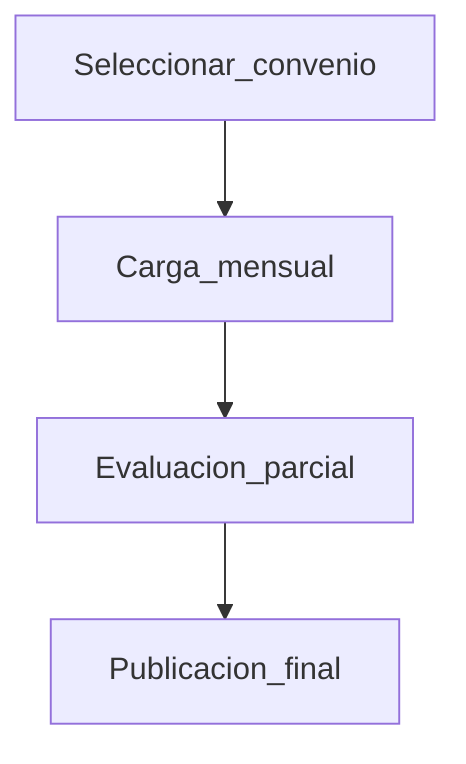

# Ejemplos (manual contextual)

Estos ejemplos están pensados para crear/editar páginas en `resources/user-manual/pages/*.md` y mantener reglas en `resources/user-manual/index.yaml`.

## Ejemplo 1: Dashboard (route exact)

### Regla en `index.yaml`

```yaml
- match: { type: route_exact, value: voyager.dashboard }
  target: { id: centinela-dashboard }
```

### Página `pages/centinela-dashboard.md` (extracto)

```md
---
id: centinela-dashboard
title: Panel principal de Centinela
version: 1.0.0
status: published
updated_at: 2026-04-26
owner: Equipo Centinela
tags: [ayuda, centinela, dashboard]
toc: true
applies_to:
    routes:
        - voyager.dashboard
---

## Objetivo

Este panel te permite ver un resumen del estado de la plataforma y acceder rápidamente a los módulos del menú.

## Cuándo usarlo

- Cuando necesitas una vista rápida del estado general.
- Cuando quieres navegar a un módulo sin buscarlo en listas.

## Paso a paso

### Ir a un módulo desde el menú

1. Abre el menú lateral.
2. Selecciona el módulo que necesitas.

**Resultado esperado:** se abre la pantalla del módulo seleccionado.
```

## Ejemplo 2: BREAD por prefijo (Voyager)

### Regla en `index.yaml`

```yaml
- match: { type: route_prefix, value: voyager.documentos. }
  target: { id: voyager-documentos }
```

### Página `pages/voyager-documentos.md` (extracto)

```md
---
id: voyager-documentos
title: Documentos (BREAD)
version: 1.0.0
status: draft
updated_at: 2026-04-26
owner: Equipo Centinela
tags: [ayuda, voyager, bread]
toc: true
applies_to:
    routes:
        - voyager.documentos.
---

## Objetivo

Este módulo permite administrar el registro de Documentos: listar, crear, editar y ordenar.

## Paso a paso

### Crear un documento

1. Selecciona **Añadir nuevo**.
2. Completa el formulario.
3. Presiona **Guardar**.

**Resultado esperado:** el registro aparece en el listado.

::::info
Si tu perfil es de solo lectura, podrás ver el listado pero no verás acciones de edición.
::::
```

## Ejemplo 3: Ruta dinámica (regex, instrumento por año)

### Regla en `index.yaml`

```yaml
- match: { type: route_regex, value: '^metas-\\d+$' }
  target: { id: metas-instrumento }
```

### Página `pages/metas-instrumento.md` (extracto)

```md
---
id: metas-instrumento
title: Metas (Instrumento)
version: 1.0.0
status: review
updated_at: 2026-04-26
owner: Equipo Centinela
tags: [ayuda, metas, instrumento]
toc: true
applies_to:
    routes:
        - metas.instrument.
        - metas-2026
---

## Objetivo

Este instrumento permite registrar y revisar avances asociados a metas del año activo.

::::warning
Si cambias el año, la pantalla puede reiniciar filtros y resultados.
::::

## Paso a paso

### Cargar información

1. Selecciona **Importar**.
2. Adjunta el archivo de plantilla.
3. Confirma el resumen de validación.

**Resultado esperado:** verás un mensaje de éxito y los datos quedarán disponibles en el listado.
```

## Ejemplo 4: Múltiples pantallas (flujo, ADP autoevaluación)

### Regla en `index.yaml`

```yaml
- match: { type: route_prefix, value: adp.self_evaluation. }
  target: { id: adp-autoevaluacion }
```

### Página `pages/adp-autoevaluacion.md` (extracto)

````md
---
id: adp-autoevaluacion
title: ADP — Autoevaluación
version: 1.0.0
status: draft
updated_at: 2026-04-26
owner: Equipo Centinela
tags: [ayuda, adp, flujo]
toc: true
applies_to:
    routes:
        - adp.self_evaluation.
---

## Objetivo

Guiarte a través del flujo de autoevaluación, desde la selección del convenio hasta la publicación final.


````
