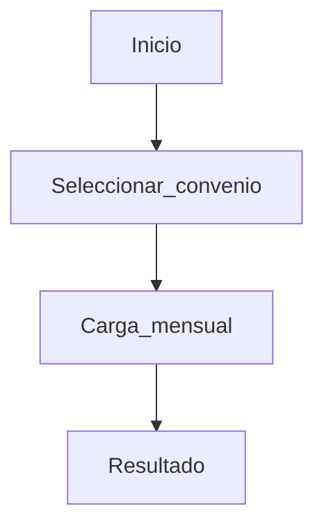

# Plantillas y snippets (Manual de usuario)

Usa estos bloques como base para crear documentos en `resources/user-manual/pages/*.md` y reglas en `resources/user-manual/index.yaml`.

## 1) Plantilla base de documento

```md
---
id: <id-kebab-case>
title: <Título visible>
version: 1.0.0
status: draft
updated_at: 2026-04-26
owner: <Equipo o persona>
tags: [ayuda, <tag1>, <tag2>]
toc: true
applies_to:
    routes:
        - <route.name.o.prefijo>
---

## Objetivo

<Qué resuelve esta pantalla/módulo y en qué contexto se usa.>

## Cuándo usarlo

- <Caso 1>
- <Caso 2>

## Paso a paso

### <Procedimiento 1>

1. <Acción concreta>
2. <Acción concreta>
3. <Acción concreta>

**Resultado esperado:** <Qué debería pasar si se hizo correctamente.>

## Errores comunes

<Listado breve o un callout.>

## Preguntas frecuentes

**<Pregunta?>**  
<Respuesta breve (2–4 líneas).>
```

## 2) Callouts (admonitions)

```md
:::::info
<Contexto o nota importante>
:::::

:::::tip
<Recomendación práctica>
:::::

:::::warning
<Riesgo o cambio de estado>
:::::

:::::danger
<Acción irreversible o impacto alto>
:::::
```

## 3) Mermaid (diagramas)

````md

````

Reglas:

- IDs de nodos sin espacios: usar `camelCase`/`snake_case`.
- No usar HTML en labels.

## 4) Procedimientos (con “Resultado esperado”)

```md
## Importar archivo

1. Selecciona **Importar**.
2. Carga el archivo de plantilla.
3. Confirma el resumen de validación.

**Resultado esperado:** verás un mensaje de éxito y el listado actualizado.
```

## 5) FAQ (breve)

```md
## Preguntas frecuentes

**¿Por qué no veo el botón “Publicar”?**  
Porque solo aparece cuando el periodo está en estado preliminar y tu rol tiene permiso.
```

## 6) Details (colapsable)

```md
<details>
<summary>Ver errores comunes</summary>

- “Archivo inválido”: usa la plantilla del año vigente.
- “Permiso denegado”: tu perfil está en modo solo lectura.
    </details>
```

Nota: si el renderer bloquea HTML raw, este artefacto puede degradar a texto plano o migrar a una macro propia.

## 7) Tabs (opcional)

```md
:::::tabs
::::tab solo_lectura

- Puedes revisar resultados y descargar reportes.
  :::::
  ::::tab editor
- Además puedes importar datos y corregir observaciones.
  :::::
  :::::
```

Reglas:

- Máximo 3 tabs por bloque.
- IDs de tab: `kebab-case` o `snake_case` (sin espacios).

## 8) Plantilla de `index.yaml`

```yaml
version: 1
defaults:
    fallback_id: general

rules:
    - match: { type: route_exact, value: voyager.dashboard }
      target: { id: centinela-dashboard }

    - match: { type: route_prefix, value: voyager.documentos. }
      target: { id: voyager-documentos }

    - match: { type: route_regex, value: '^metas-\\d+$' }
      target: { id: metas-instrumento }
```
