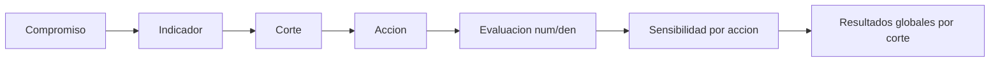

# COMGES — lógica de cálculo y cortes

Documento de negocio consolidado para el instrumento **COMGES**. Última formalización de contenido: **2026-07-09** · higiene de fecha (paridad con ciclo de vida): **2026-10-07** (; sin cambio de reglas de cálculo).

**Referencias técnicas:** `ComgesYearMode` · `CurrentCutoffPolicy` · `ComgesResultsService`

**Reglas transversales:** [domain-rules.md](domain-rules.md) · [instrumentos-plataforma.md](instrumentos-plataforma.md)

**Ciclo de vida (etapas, roles, OOTT):** [comges-ciclo-vida.md](comges-ciclo-vida.md)

---

## 1. Resumen del flujo de cálculo

1. Un **compromiso** agrupa indicadores COMGES del año activo.
2. Cada **indicador** tiene cortes, acciones y configuración por SS.
3. El **referente** (o CG/admin según política) registra **evaluaciones** con numerador y denominador por acción y corte.
4. La **sensibilidad** (tabla por acción, con selección por SS cuando aplica) determina cumplimiento/puntaje de la evaluación.
5. Los **resultados globales** agregan evaluaciones por corte según el modo de año (% o puntaje).

---

## 2. Escalas por año (`ComgesYearMode`)

| Año del instrumento | Escala | Regla |
| ------------------- | ------ | ----- |
| **`ano < 2025`** | Porcentaje (0–100 %) | `cumplimiento` interpretado como %; agregación legacy en modo `percentage` |
| **`ano >= 2025`** | Puntaje (0–4) | `cumplimiento` interpretado como puntaje; agregación en modo `score` |

Constantes relevantes:

- `SCORE_SCALE_FIRST_YEAR = 2025` — inicio escala puntaje.
- `MONITORING_CUTOFF_FIRST_YEAR = 2026` — cortes de monitoreo con claves CORTE I/II/ÚNICO.
- En **2025**, el corte Apelación puede ocultar sensibilidad y evaluaciones por acción (solo carga de apelaciones).

Toda modificación COMGES debe validar **ambas ramas** de año antes de merge.

---

## 3. Cálculo por evaluación

- Cada evaluación (`com_evaluations`) aporta **numerador** y **denominador** por acción.
- El cumplimiento de la evaluación se deriva del resultado y la **tabla de sensibilidad** asociada a la acción (con selección por SS cuando el modelo lo exige).
- Importación masiva y BREAD de evaluaciones deben invalidar caché de resultados globales (ver §6).

**Convergencia futura (P1):** el cálculo num/den inline de COMGES se expresará como caso trivial del motor de fórmulas común, preservando paridad bit a bit con resultados vigentes.

---

## 4. Agregación de resultados globales (`ComgesResultsService`)

Servicio unificado  con dos modos según año:

### Modo porcentaje (`ano < 2025`)

- Cada evaluación contribuye: `(cumplimiento/100) * (ponderacion_accion/100) * ponderacion_indicador`.
- Totales por `cutoff_id`: sumas redondeadas a 2 decimales.
- Paridad obligatoria con el partial legacy (tolerancia ±0.01 por redondeo).

### Modo puntaje (`ano >= 2025`)

- Conservar reglas de agregación vigentes: excluir evaluaciones de **apelación** y **`evaluacion_local`** del agregado global.
- Agregar por cutoff según `ComgesResultsService` / contexto 2025+.

### Caché

- Clave: `comges_global_results_v4_{cen_hie_dependency_id}_{year_id}`.
- TTL: 3600 s.
- **Invalidar** al persistir evaluaciones (importación masiva con filas OK, BREAD evaluaciones, limpieza autoevaluaciones).
- El cambio de año en sesión usa otra clave por `year_id` (no requiere `forget` explícito).

---

## 5. Cortes, etapas y políticas de edición

Contexto del ciclo operativo (OOTT, parametrización, transición de etapas): [comges-ciclo-vida.md](comges-ciclo-vida.md).

Gates Laravel: `current-add-edit`, `current-download` (`CurrentCutoffPolicy`).

### Quién puede editar (`current-add-edit`)

| Rol | Condición |
| --- | --------- |
| **admin**, **control-gestion** | Instrumento habilitado para la SS y etapa vigente (`indicatorTypeSettings`) |
| **referente** | Además: usuario asignado al indicador, intervalo de fechas (o `mantener_abierto`), corte en `pestanas_editables`, etapa `AUTOEVALUACION` o `APELACION` |
| **visualizador**, **parametrizador** | Sin edición vía esta policy (salvo excepciones documentadas por escrito) |

### Quién puede descargar medios (`current-download`)

| Rol | Condición |
| --- | --------- |
| **admin**, **control-gestion** | Siempre |
| **referente** | Si está en la lista de usuarios del `ComIndicatorSetting` del indicador |
| Otros | Denegado |

### Configuración evaluada

1. **Por instrumento-año-SS:** `indicatorTypeSettings` — habilitado, etapa vigente.
2. **Por indicador-SS:** `comIndicatorSettings` — usuarios asignados, fechas apertura/cierre (08:00–17:00), pestañas editables (cortes).

---

## 6. Sensibilidad y alertas

- Tablas de sensibilidad por acción; en años 2025+ pueden existir selecciones pendientes por SS (`hasSensitivityTableSelectionPendingForDependency`).
- Alertas visuales en vista de compromisos según reglas 2025+; no aplicar reglas 2025 a años históricos.
- Normalización de rangos: `ComSensitivityTable::normalizeValorRule` (reutilizada por ADP).

---

## 7. Roles en COMGES (resumen)

| Acción | admin | parametrizador | control-gestion | referente | visualizador |
| ------ | ----- | -------------- | --------------- | --------- | ------------ |
| Ver compromisos sin indicadores | Sí | Sí | No | No | Lectura |
| Editar al corte (evaluaciones) | Según policy | No | Según policy | Según policy | No |
| Descargar medios verificación | Sí | Según asignación | Sí | Si asignado | No |
| Resultados globales | Sí | Sí | Sí | Según SS | Lectura |

Detalle: [modulos-roles.md](modulos-roles.md).

---

## 8. Convergencia y restricciones

- **Inmutabilidad:** resultados de cierres COMGES ya publicados no se recalculan sin alcance documentado con paridad verificada.
- **Mayor acoplamiento Voyager:** COMGES concentra BREAD de compromisos, evaluaciones y carga; la migración a Filament (T2) se coordina con P1.
- **Granularidad:** evaluación a nivel **Servicio de Salud** (no establecimiento como Metas).

---

## 9. Checklist rápido para cambios COMGES

- [ ] ¿Impacto en `ano < 2025` y `ano >= 2025`?
- [ ] ¿Afecta `CurrentCutoffPolicy` o gates de corte?
- [ ] ¿Requiere invalidar caché `comges_global_results_v4_*`?
- [ ] ¿Filtrado por `cen_hie_dependency_id` en evaluaciones y resultados?
- [ ] ¿Paridad de agregación global documentada si cambia el servicio?
