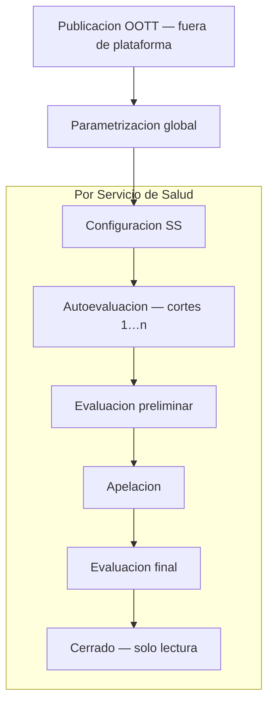

# COMGES — ciclo de vida del módulo

Documento de **negocio** que describe el ciclo operativo del instrumento **COMGES** en Centinela: fases, roles y alcance (global vs por Servicio de Salud). Complementa el detalle de cálculo en [comges-calculo.md](comges-calculo.md).

**Reglas transversales:** [domain-rules.md](domain-rules.md) · [instrumentos-plataforma.md](instrumentos-plataforma.md) · [modulos-roles.md](modulos-roles.md)

Última formalización: **2026-09-01**.

---

## 1. Resumen

El ciclo COMGES combina dos capas:

| Capa | Alcance | Responsable típico |
| ---- | ------- | ------------------ |
| **Parametrización del instrumento** | Global — una definición para todos los SS | **parametrizador** |
| **Configuración y operación** | Por Servicio de Salud y año indicador | **control-gestion** (apertura, cierres) · **referente** (carga) |

Las **etapas vigentes** del instrumento por SS (`indicatorTypeSettings.etapa_vigente`) gobiernan qué puede hacer cada rol en la plataforma. Los **cortes** del año de medición (cantidad y tipo según OOTT; p. ej. Corte 1, Corte 2, …, Corte *n*) estructuran la carga dentro de la etapa de **Autoevaluación**. Según la OOTT, cada corte puede ser una **evaluación local (monitoreo)** o un **corte anual**.

---

## 2. Fases del ciclo

### 2.1 Publicación de orientaciones técnicas (OOTT) — fuera de la plataforma

El ciclo **inicia fuera de Centinela** con la publicación, por parte del MINSAL, de las **orientaciones técnicas** (OOTT) que definen el marco del instrumento para el año en curso.

Centinela no modela esta fase; las OOTT son el insumo normativo que guía la parametrización posterior.

### 2.2 Parametrización global del instrumento

**Rol:** parametrizador (y admin).

**Alcance:** una configuración **única para todos los Servicios de Salud** del año indicador.

En base a las OOTT, se parametriza el catálogo COMGES:

- **Compromisos** e **indicadores** del año.
- **Cortes** del período de medición (cantidad según OOTT; habitualmente varios cortes en el año).
- **Acciones** (secciones a evaluar) dentro de cada corte, cada una con su **ponderación** para el cálculo global del indicador.
- **Tablas de sensibilidad** asociadas a cada indicador (definición global; la selección por SS ocurre en la fase siguiente).

Esta fase corresponde principalmente al panel administrativo (`/admin`) y al BREAD de compromisos, indicadores, cortes y sensibilidad. No depende de la etapa vigente por SS.

### 2.3 Configuración del módulo por Servicio de Salud

**Rol:** control de gestión (y admin).

**Alcance:** por **Servicio de Salud** y año indicador.

Antes de abrir la operación a referentes, el CG del SS debe:

1. **Seleccionar las tablas de sensibilidad** que aplican a su SS (cuando el indicador ofrece más de una opción).
2. **Asignar referentes** por indicador.
3. **Abrir el instrumento** para el SS, estableciendo la etapa **Autoevaluación** (`etapa_vigente = AUTOEVALUACION`, `habilitado = true`).
4. **Configurar cada indicador** del SS: pestañas editables (cortes habilitados) y fechas de apertura/cierre por indicador (`comIndicatorSettings`).

Hasta completar esta configuración, el SS no opera el ciclo de carga.

### 2.4 Autoevaluación

**Etapa vigente:** `AUTOEVALUACION`.

**Roles:**

| Rol | Acción |
| --- | ------ |
| **referente** | Carga **autoevaluación** (numerador/denominador por acción y corte) y **medios de verificación**, dentro de las ventanas configuradas, en los cortes habilitados y si está asignado al indicador. |
| **control-gestion** | Puede operar en nombre del SS según `CurrentCutoffPolicy`; gestiona aperturas y ventanas. |

Los **cortes** del año estructuran la carga: en cada corte el referente registra evaluaciones por acción. Su cantidad y naturaleza (monitoreo local o corte anual) las define la OOTT del año. La sensibilidad seleccionada determina el cumplimiento o puntaje de cada evaluación (ver [comges-calculo.md](comges-calculo.md) §3).

### 2.5 Evaluación preliminar

**Etapa vigente:** `PRELIMINAR`.

**Rol principal:** control de gestión.

Al avanzar a esta etapa, el CG **registra los resultados de la evaluación preliminar** — datos provenientes de la evaluación externa (MINSAL, SEREMI, DIPRES u otro organismo según el marco del año). En la plataforma esto se materializa como evaluaciones de tipo `PRELIMINAR` (carga masiva o registro directo).

Los **referentes** no editan evaluaciones en esta etapa; el instrumento queda en modo de registro institucional por CG/admin.

### 2.6 Apelación

**Etapa vigente:** `APELACION`.

**Rol principal:** referente (asignado al indicador).

Abierta la etapa de apelación, los referentes pueden **presentar apelaciones** como **medios de verificación** documentales, dentro de las ventanas y cortes habilitados.

Las evaluaciones de apelación **no se agregan** al resultado global en modo puntaje (`ano >= 2025`); se conservan para trazabilidad y resolución en la etapa final (ver [comges-calculo.md](comges-calculo.md) §4).

### 2.7 Evaluación final

**Etapa vigente:** `FINAL`.

**Rol principal:** control de gestión.

El CG **registra la evaluación final** del período, incorporando las resoluciones de las apelaciones cuando corresponda. Corresponde a evaluaciones de tipo `FINAL`.

### 2.8 Cerrado

**Etapa vigente:** `CERRADO`.

El ciclo del año indicador para ese SS **concluye**. El sistema permanece en **solo lectura** para todos los roles en ese instrumento-año-SS.

Los resultados publicados en cierre son **inmutables** salvo alcance documentado con paridad verificada ([domain-rules.md](domain-rules.md) · [comges-calculo.md](comges-calculo.md) §8).

---

## 3. Etapas vigentes y cortes

| Concepto | Descripción |
| -------- | ----------- |
| **Etapa vigente** | Fase del ciclo a nivel SS-año (`indicatorTypeSettings`). Valores COMGES: `AUTOEVALUACION` → `PRELIMINAR` → `APELACION` → `FINAL` → `CERRADO`. |
| **Corte** | Período de reporte dentro del año (varios cortes según OOTT; p. ej. monitoreos locales o cortes anuales). Aplica principalmente en **Autoevaluación** y, según configuración, en **Apelación**. |
| **Pestañas editables** | Cortes habilitados por indicador-SS (`comIndicatorSettings.pestanas_editables`). |
| **Tipo de evaluación** | `AUTOEVALUACION`, `PRELIMINAR`, `FINAL` — distinto de la etapa vigente; determina qué datos se cargan en cada fase. |

Las etapas `NO_INICIADO` y `FORMULACION` del enum compartido `EtapaVigente` corresponden al **ciclo de vida de Metas**, no al ciclo operativo COMGES.

---

## 4. Políticas de edición por etapa

Resumen alineado con `CurrentCutoffPolicy`:

| Etapa | referente | control-gestion / admin |
| ----- | --------- | ----------------------- |
| **Autoevaluación** | Carga evaluaciones y medios (si asignado, en ventana y corte habilitado) | Operación según instrumento habilitado |
| **Preliminar** | Solo lectura | Registro de evaluación preliminar |
| **Apelación** | Carga apelaciones como medios verificables | Operación según instrumento habilitado |
| **Final** | Solo lectura | Registro de evaluación final |
| **Cerrado** | Solo lectura | Solo lectura |

Detalle de gates (`current-add-edit`, `current-download`) y configuración evaluada: [comges-calculo.md](comges-calculo.md) §5.

---

## 5. Diferencias con Metas

| Dimensión | COMGES | Metas |
| --------- | ------ | ----- |
| **Inicio del ciclo** | OOTT (fuera de plataforma) → parametrización global | OOTT (fuera de plataforma) → parametrización global |
| **Parametrización** | Global (una vez para todos los SS) | Catálogo global; convenio y ponderaciones por establecimiento |
| **Granularidad de carga** | Servicio de Salud | Establecimiento / unidad interna |
| **Calendario intra-año** | Tres cortes fijos | Meses / trimestres / semestres |
| **Etapas** | Autoevaluación → Preliminar → Apelación → Final → Cerrado | No iniciado → Formulación → Autoevaluación → … → Cerrado |
| **Evaluación externa** | Preliminar y Final registradas por CG | Preliminar/Final con reglas propias por ley |

Detalle Metas: [metas-ciclo-vida.md](metas-ciclo-vida.md).

---

## 6. Checklist rápido para cambios COMGES (ciclo)

- [ ] ¿Afecta parametrización global vs configuración por SS?
- [ ] ¿Impacta transición de `etapa_vigente`?
- [ ] ¿Qué rol opera en la etapa afectada (parametrizador, CG, referente)?
- [ ] ¿Afecta ventanas por indicador (fechas, pestañas editables, cortes)?
- [ ] ¿Afecta `CurrentCutoffPolicy` o tipos de evaluación (`AUTOEVALUACION` / `PRELIMINAR` / `FINAL`)?
- [ ] ¿Requiere el instrumento habilitado (`habilitado`) para el SS?
