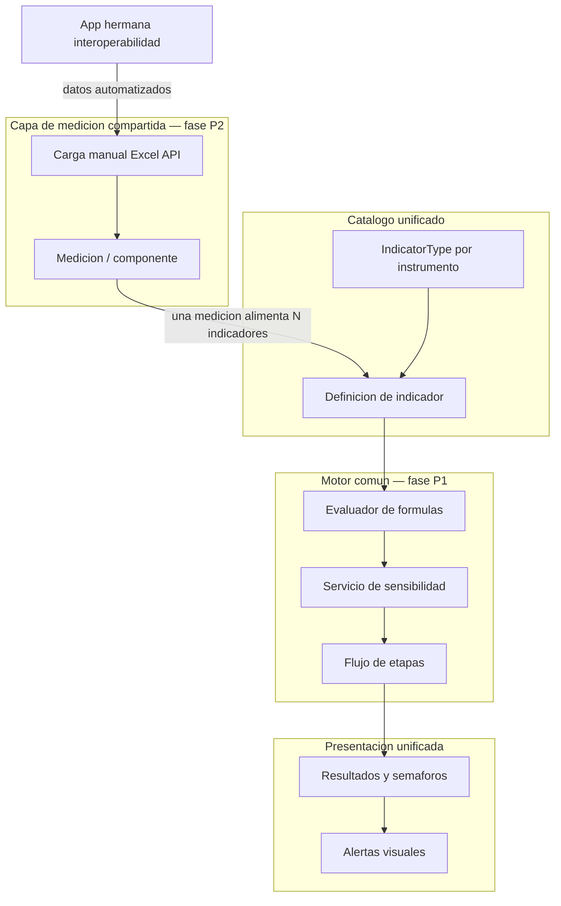

# Instrumentos de evaluación — visión de plataforma

Documento de **negocio** que define la identidad de producto de Centinela y el marco de convergencia entre instrumentos. Complementa [domain-rules.md](domain-rules.md) (reglas transversales) y los documentos por instrumento.

**Contexto arquitectónico:** evolución de plataforma / admin Voyager.

Última formalización: **2026-10-07** (alineamiento con F2 publicado; visión P1–P3 sin cambio de alcance).

---

## 1. Identidad de producto

Centinela es una **plataforma de instrumentos de evaluación** para Servicios de Salud (SS) del MINSAL (Chile). Su núcleo operativo son los instrumentos de seguimiento y evaluación; el resto son módulos de soporte.

| Categoría | Módulos |
| --------- | ------- |
| **Núcleo (instrumentos)** | COMGES · Metas Ley 18.834 · Metas Ley 19.664 · Metas Ley 20.707 · ADP (Alta Dirección Pública) |
| **Accesorios** | Soporte (tickets) · Chat IA · Manual contextual · Visualizador SNSS (establecimientos) · Supervisión/deploy |

Los usuarios operan siempre en el contexto de su **Servicio de Salud** y su **rol**. La confidencialidad entre SS es obligatoria ([domain-rules.md](domain-rules.md)).

---

## 2. Principio rector: chasis unificado, reglas por instrumento

Ni un flujo idéntico forzado para todos los instrumentos ni el statu quo de flujos totalmente paralelos.

**Unificar el chasis** — lo que todos los instrumentos comparten estructuralmente:

- Ciclo: **parametrización → carga de datos → cálculo → resultados → etapas** (preliminar / apelación / final).
- Catálogo de indicadores y habilitación por SS (`indicator_types`, `service_module_toggles`).
- Motor de fórmulas, servicio de sensibilidad y presentación de resultados (semáforos, tablas, alertas visuales).
- Navegación y estructura visual unificada (objetivo: tema Filament v5 + Tailwind 4; ver §7).

**Mantener como reglas por instrumento** — estrategias sobre el chasis:

| Dimensión | COMGES | Metas (3 leyes) | ADP |
| --------- | ------ | --------------- | --- |
| **Granularidad** | Servicio de Salud | Establecimiento / unidad interna | Cargo-establecimiento por convenio |
| **Calendario** | 3 cortes fijos + apelación | Meses / trimestres / semestres + ciclo de etapas | Periodos anuales móviles (p. ej. mar–mar) |
| **Carga** | Por acción y corte | Multi-campo mensual (`met_monthly_data`) | Mensual parcial (1 valor/mes por indicador) |
| **Escala de cumplimiento** | % (`ano < 2025`) o puntaje 0–4 (`ano ≥ 2025`) | % y semáforos por ley | % / sensibilidad / dicotómico |
| **Etapas** | Parametrización global → configuración SS → Autoevaluación (cortes) → Preliminar → Apelación → Final → Cerrado | Parametrización global → No iniciado → Formulación → Autoevaluación → … → Cerrado | Autoevaluación → preliminar → apelaciones → final |

Detalle por instrumento: [comges-ciclo-vida.md](comges-ciclo-vida.md) · [comges-calculo.md](comges-calculo.md) · [metas-ciclo-vida.md](metas-ciclo-vida.md) · [metas-calculo.md](metas-calculo.md) · [adp-operativo.md](adp-operativo.md).

---

## 3. Arquitectura objetivo de negocio

**Estado actual (2026-10):** catálogo y habilitación unificados; evaluador de fórmulas compartido (Metas + ADP); normalización de sensibilidad compartida (COMGES + ADP). **Fundación F2:** año activo vía `YearContext` + `FiltersByActiveYear` (v4.13.0); tenancy SS vía `BelongsToHealthService` mínimo (v4.14.0; oleadas diferidas). **Pendiente (visión P, aún no publicada):** motor/sensibilidad unificados en sombra (P1), capa de medición compartida (P2), API de interoperabilidad (P3 / P3a).

---

## 4. Invariantes de convergencia

Estas reglas gobiernan los cambios de las fases P1–P3 y la visión de plataforma (hoy en pausa). El chasis F2 (año + tenancy) ya está **publicado** en v4.x; no reabrir como «futuro».

1. **Resultados históricos inmutables** — Los resultados ya publicados (cierres COMGES, cierres Metas) no se alteran retroactivamente. Toda convergencia de motores (P1) exige **paridad bit a bit** con el cálculo vigente antes del switch, con tests y validación en sombra durante al menos un ciclo real cuando aplique.

2. **Nuevos instrumentos solo vía chasis** — Ningún instrumento nuevo debe crear un cuarto motor de cálculo ni un cuarto catálogo aislado. Se incorpora mediante configuración sobre el chasis común.

3. **Interoperabilidad planificada (P3)** — Dirección de producto confirmada: una aplicación hermana consumirá/escribirá vía **API acotada sobre la capa de medición**, no sobre esquemas internos `com_` / `met_` / `adp_`. El stack de la app hermana es decisión independiente. **Estado:** diferido (ver strangler-board P3 / P3a); no confundir con endpoints ops actuales.

4. **Segmentación por SS no negociable** — Toda consulta o mutación operativa respeta `cen_hie_dependency_id` del usuario autenticado. Chasis vigente: trait `BelongsToHealthService` (GlobalScope; sin bypass `admin` en el trait; activación por modelo).

5. **Año activo transversal** — Año del instrumento vía servicio `YearContext` (clave de sesión `indicator_year` sin renombrar) y trait `FiltersByActiveYear` (`scopeCurrentYear`) — vigente. Sin lecturas ad hoc dispersas salvo justificación por escrito.

6. **Bifurcación COMGES por año** — Reglas distintas para `ano < 2025` (porcentaje) y `ano ≥ 2025` (puntaje 0–4) permanecen hasta que un alcance documentado indique lo contrario con paridad verificada.

---

## 5. Restricciones operativas

- **Continuidad:** la plataforma debe permanecer operable entre fases del roadmap; no hay ventanas de cambio que crucen **cortes COMGES** ni **cierres Metas** sin acuerdo explícito.
- **Validación funcional:** cambios en flujos de instrumentos requieren validación con **Control de Gestión** y **Referentes** antes de retirar funcionalidad equivalente (p. ej. BREAD Voyager → Filament Resource).
- **Developer solo:** el roadmap se ejecuta intercalado con trabajo funcional; priorizar incrementos acotados con tests en verde.

---

## 6. Transición del shell administrativo

La decisión de evolución de plataforma adopta **Filament v5** como panel admin objetivo, reemplazando progresivamente **Voyager** y el kit **Compass**.

| Aspecto | Regla de negocio |
| ------- | ---------------- |
| **Qué cambia** | UI de parametrización, menú `/admin`, CRUD de catálogos, design system (Tailwind 4). |
| **Qué no cambia** | Reglas de dominio en este directorio; servicios de cálculo; segmentación SS; roles (5 invariantes). |
| **Flujos operativos** | Carga, cálculo y resultados de instrumentos siguen en **Livewire a medida**, integrados en páginas custom del panel Filament — no como CRUD genérico. |
| **Convivencia** | Durante la transición pueden coexistir Voyager, Compass y Filament; usar feature flags por módulo. |

---

## 7. Roadmap de negocio (resumen)

Detalle técnico: evolución de plataforma / admin Voyager.

| Vía | Fases | Objetivo de negocio | Estado (2026-10) |
| --- | ----- | ------------------- | ---------------- |
| **F** (fundación) | F0–F2 | Seguridad, esquema BD versionado, `YearContext` y tenancy unificado | **F0–F2a/F2b mínimo publicado** en v4.x (…222). Oleadas tenancy y F1c seeders: no inventar reglas aquí. |
| **T** (técnica) | T0–T3 | Laravel 11/12, panel Filament, migración BREAD, retiro Voyager/Compass | Pendiente (T0+). Kit Compass: sunset; Descartado. |
| **P** (producto) | P1–P3 | Motor y sensibilidad unificados → capa de medición → API interoperabilidad | **Pendiente / diferido** — visión de plataforma sin cambio; sin convergencia P1–P3 publicada. |
| **C** (continua) | C1 | UI instrumentos en tema Filament + mejora de rendimiento medida | Pendiente |

Tag **`v5.0.0`** = primer deploy de **T0** (Laravel 11), no una rama `release/v5.0.0`.
Fundación F0–F2 (mínimo) ya salió en **v4.x**; T0+ y P1–P3 siguen el roadmap. Operación: evolución de plataforma / admin Voyager.

---

## 8. Trabajo futuro documentado

- **Indicadores replicados:** inventario técnico cerrado. **Solución diferida a `v5.0.0` / fase P2** (capa de medición compartida). Sin cambios de producto en v4.x.
- **P1–P3:** permanecen como visión de convergencia; no hay publicación que avance motor común, medición unificada ni API sobre medición.
- **Mapa detallado de permisos** por pantalla: ver [modulos-roles.md](modulos-roles.md); ampliar según evolución Filament.
- **ADP:** suite en pausa; [adp-operativo.md](adp-operativo.md) es borrador, no invariante definitivo.

---

## Documentos relacionados

| Documento | Contenido |
| --------- | --------- |
| [domain-rules.md](domain-rules.md) | Reglas transversales e invariantes para cambios y PRs |
| [comges-ciclo-vida.md](comges-ciclo-vida.md) | Ciclo de vida COMGES (etapas, roles, OOTT) |
| [comges-calculo.md](comges-calculo.md) | Cálculo y cortes COMGES |
| [metas-ciclo-vida.md](metas-ciclo-vida.md) | Ciclo de vida Metas (OOTT, etapas, convenio, roles) |
| [metas-calculo.md](metas-calculo.md) | Cálculo Metas (3 leyes) |
| [adp-operativo.md](adp-operativo.md) | ADP — borrador formal (suite en pausa) |
| [modulos-roles.md](modulos-roles.md) | Matriz módulo × rol |
