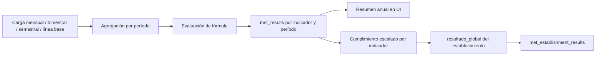

# Metas — lógica de cálculo

Documento de negocio consolidado para instrumentos **Metas** (`metas-18834`, `metas-19664`, `metas-20707`, etc.). Última revisión: **2026-08-31**.

**Referencias técnicas:** configuración de campos por SS · perfil de ratio porcentual · `MetCalculationService`

**Reglas transversales:** [domain-rules.md](domain-rules.md) · [instrumentos-plataforma.md](instrumentos-plataforma.md)

**Ciclo de vida (etapas, convenio, roles):** [metas-ciclo-vida.md](metas-ciclo-vida.md)

---

## 1. Resumen del flujo de cálculo



1. El referente carga datos en `met_monthly_data`.
2. El motor agrega variables por **período** (`MES-*`, `TRIM-*`, `SEM-*`, `ANUAL`) según tipo de entrada y configuración por SS.
3. Se evalúa la **fórmula** del indicador y se persiste en `met_results`.
4. En pantallas de resumen, un **presentador** puede sintetizar una fila anual a partir de los períodos subanuales.
5. Con los resultados y la **meta efectiva**, se calcula el **cumplimiento ponderado** y el **resultado global** del establecimiento.

---

## 2. Períodos de cálculo

La **periodicidad operativa** del indicador (por SS y año) se deduce del numerador con mayor desagregación (periodicidad desde el numerador):

| Periodicidad | Períodos calculados |
| ------------ | ------------------- |
| Mensual | `MES-01` … `MES-12` |
| Trimestral | `TRIM-1` … `TRIM-4` |
| Semestral | `SEM-1`, `SEM-2` |
| Anual | `ANUAL` |

Además existe el período **`ANUAL`** como resumen en UI y en `met_establishment_results`, aunque el indicador sea subanual.

---

## 3. Tipos de entrada y agregación por componente

Cada variable del indicador (`met_data_field`) tiene:

- **`input_type`:** cómo se captura (mensual, trimestral, semestral, anual, línea base).
- **`aggregation_type`:** cómo se combinan los valores en el tiempo (**solo** si el tipo de entrada lo exige).

Valores de agregación:

| `aggregation_type` | Significado en el tiempo |
| ------------------ | --------------------------------------------------------------------------------------------- |
| `sumatoria` | Se **suman** los valores de cada subperíodo (p. ej. numerador mensual en el año). |
| `ultimo_dato` | Se toma el valor del **último subperíodo con dato** (p. ej. numerador trimestral del TRIM-4). |

**Línea base** (`input_type = linea_base`) no tiene `aggregation_type`: un único valor fijo por establecimiento, **no se suma** entre períodos.

Los tipos efectivos pueden definirse **por Servicio de Salud** en `met_field_ss_configs`; si no hay fila SS, se usa la maqueta global del campo (configuración de campos por SS).

---

## 4. Cálculo por período (persistido en `met_results`)

Servicio principal: `MetCalculationService::calculateIndicatorPeriod`.

### 4.1 Variables y componentes primarios

1. `MetDataAggregatorService` obtiene valores de `met_monthly_data` para el establecimiento (y adosados, si aplica; ver §4.1.1 si `agrupa_ss` está activo).
2. Se resuelven variables de la fórmula (`A`, `B`, …).
3. Se derivan **numerador** y **denominador** primarios cuando la fórmula es ratio simple.

### 4.1.1 Agrupación a nivel Servicio de Salud (`agrupa_ss`)

Algunos indicadores transversales (cobertura global, dotación, listas de espera, etc.) deben calcularse con los datos de **todo el Servicio de Salud**, no solo del establecimiento que figura en pantalla. Para eso existe la bandera **`agrupa_ss`** en `met_indicator_configurations`, configurada por centro e indicador en el modal «Indicadores» de la selección de establecimientos (decisión de arquitectura).

Cuando `agrupa_ss = true` para un par `(indicador, establecimiento)`, el motor de cálculo amplía el universo de `met_monthly_data` más allá del centro madre y sus adosados manuales (`met_center_adosados`): suma también los datos de **todos los demás centros del mismo SS con `aplica = true`** para ese indicador y año, excluyendo el propio centro que calcula. La relación con los adosados es **aditiva** (unión sin duplicados).

Requisitos: `aplica = true` en la misma fila; no exige `seleccionado` (convenido). La resolución de centros extra la hace `MetCalculateResultsJob` / `MetAutoevaluacionCalculationRunner`; `MetDataAggregatorService` solo recibe la lista de IDs ya resuelta y agrega variables igual que con adosados — en campos mensuales suma por período; en **línea base** suma el valor de todos los centros del universo ampliado (corrección v4.1.3).

**`agrupa_ss` no altera la carga de datos**: cada centro sigue cargando en su propia ficha; el flag solo cambia qué registros entran al cálculo del resultado del centro que lo tiene activo. Desde, los adosados manuales se resuelven por instrumento; `agrupa_ss` sigue filtrando por `cen_hie_dependency_id` del SS.

La pestaña **Desempeño** del catálogo de indicadores usa el **mismo universo** para `estado_carga`, columna **Datos al**, **cumplimiento** y resumen anual de **fórmula compleja** (`MetIndicatorCalculationDataScopeService`, `MetIndicatorLastLoadedMonthService` y `MetResultAggregationPresenter`): un centro con `agrupa_ss` puede mostrar resultado y cumplimiento aunque no tenga filas locales en `met_monthly_data`, si hay carga en otros centros aplicables del SS.

La vista **resultados por establecimiento** (`admin/metas-{instrumento}/resultados-por-establecimiento/{centro}`) resuelve su columna **Datos al** sobre ese mismo universo desde: antes miraba solo las filas locales del centro presentado y etiquetaba «Sin datos» filas que sí mostraban cifras provenientes de adosados o de `agrupa_ss`. La etiqueta «Sin datos» queda reservada a la ausencia de carga en **todo** el universo.

### 4.2 Evaluación de la fórmula

- Expresión JSON en `met_formulas` (sin `eval`).
- `MetIndicatorEvaluationService` aplica reglas de **perfil** (ratio porcentual 1:1 vs genérico) según y perfil de ratio porcentual.

### 4.3 Decimales del resultado

Cada indicador define:

- `decimales` (cantidad).
- `decimales_modo`: `redondear` o `truncar`.

| Modo | Efecto (2 decimales) |
| ----------- | --------------------- |
| `redondear` | `89,147…` → **89,15** |
| `truncar` | `89,147…` → **89,14** |

Se aplica al **guardar** cada `met_results.resultado` del período.

### 4.4 Cumplimiento de meta (`cumple_meta`)

Se evalúa `resultado` frente a `meta_efectiva` (configuración del establecimiento) o `meta_valor` (catálogo), con `meta_operador` (`>=`, `<=`, etc.). **No** usa umbrales inferior/superior.

### 4.5 Divisor cero y «sin casos» (ratio 1:1)

Resumen:

| Numerador | Denominador | Subperíodo | Anual / agregado |
| --------- | ----------- | -------------------------- | -------------------------- |
| 0 | 0 | `resultado = 0`, sin error | `resultado = 0`, sin error |
| 0 | ≠ 0 | `resultado = 0` | `resultado = 0` |
| ≠ 0 | ≠ 0 | Cálculo normal | Cálculo normal |
| ≠ 0 | 0 | Error divisor cero | Error divisor cero |

---

## 5. Resumen anual en pantalla (`MetResultAggregationPresenter`)

En **resultados por establecimiento**, modal «Ver datos» y desempeño del catálogo, cuando no existe fila `ANUAL` persistida se **sintetiza** un resumen anual desde los períodos subanuales.

Servicio: `MetResultAggregationPresenter::aggregatePeriodResultsToAnnualSummary`.

### 5.1 Reglas de agregación de componentes

Tras ordenar los períodos, se obtienen numerador y denominador del resumen:

| Componente | `sumatoria` | `ultimo_dato` / no acumulativo |
| ---------------------- | ------------------------------------------ | --------------------------------------------- |
| Numerador | Suma de todos los subperíodos | Valor del **último** subperíodo con resultado |
| Denominador sumatoria | Suma de todos los subperíodos | — |
| Denominador línea base | Valor fijo del último período (no se suma) | Valor fijo del último período |

**Ejemplo sumatoria + línea base:** numerador mensual sumatoria y denominador línea base 96 → anual = `(Σ numeradores) / 96 × 100` con truncamiento del indicador (p. ej. 16/96 → **16,66**, no 16,64 por promediar meses truncados).

**Ejemplo último dato + línea base:** numerador trimestral último dato TRIM-4 = 115, denominador 129 → anual = `115/129×100` truncado → **89,14** (no 89,13 por factor inferido de trimestres anteriores).

### 5.2 Regla crítica: fórmula sobre componentes agregados (enmienda 2026-06-10)

> **Cuando existen numerador y/o denominador primarios almacenados en los subperíodos**, el resultado anual de presentación se obtiene **aplicando la fórmula del indicador** sobre los componentes ya agregados (suma o último dato), con el `decimales_modo` del indicador.

**Prohibido** para ese caso: inferir un «factor de escala» desde `resultado / (numerador/denominador)` de un subperíodo anterior truncado y multiplicarlo por el cociente anual. Ese atajo producía desvíos de 0,01 o más (casos reales: MET-18834-2025-16, MET-18834-2025-08 / establecimiento 124010).

Orden de decisión del presentador:

1. Si existe fila `ANUAL` en `met_results` → usar sus valores (salvo error).
2. Si **todos** los campos efectivos son `ultimo_dato` → último subperíodo completo.
3. Calcular numerador/denominador agregados según §5.1.
4. Si hay componentes primarios almacenados → **`evaluateAggregatedComponents`** (fórmula + decimales).
5. Si no hay par numérico primario (fórmula compuesta) → último `resultado` persistido o evaluación vía servicio de indicador.
6. Fallback histórico con factor de escala: solo cuando **no** aplica el paso 4.

### 5.3 Columnas acumuladas en modal «Ver datos»

`appendCumulativePeriodData` aplica la misma lógica de sumatoria por componente para columnas «acumulado» en indicadores con numerador sumatoria; el denominador en línea base **no** se suma entre filas.

En **fórmula compleja** (varios componentes primarios), `appendComplexCumulativePeriodData` re-agrega las variables del universo de cálculo (centro + adosados + `agrupa_ss`) período a período y reevalúa la fórmula; no usa el atajo num/den primario ni suma resultados mensuales.

La columna Resultado **acumulado** del modal muestra el resultado YTD del indicador; el **Cumpl. acumulado** (misma fila) aplica §6.1 sobre ese valor. Orden de columnas finales con sumatoria: Resultado mensual → Cumpl. mensual → Resultado acumulado → Cumpl. acumulado.

---

## 6. Cumplimiento y resultado global del establecimiento

### 6.1 Cumplimiento de un indicador ()

Para un indicador comprometido (`seleccionado = true`), el **porcentaje visible** en tablas y modales es lineal respecto de la meta, acotado a **[0 %, 100 %]**, **sin umbrales**, y **sensible a la polaridad** de `meta_operador`:

| `meta_operador` | Fórmula |
| --------------- | ------- |
| `>=`, `>`, `=`, o `null` | `cumplimiento = max(0, min(100, resultado / meta_efectiva × 100))` |
| `<=`, `<` | `cumplimiento = max(0, min(100, meta_efectiva / resultado × 100))` |

**Polaridad directa (`>=` / `>` / `=`):** el sobrecumplimiento se muestra como 100 %. Un resultado negativo (válido en algunos indicadores) **no** produce cumplimiento negativo: se muestra 0 %.

**Polaridad inversa (`<=` / `<`):** un resultado **bajo** la meta (mejor) se topa en 100 %. Un resultado **sobre** la meta (peor) queda bajo 100 % (p. ej. 40,65 / meta 37,58 → ≈ 92,45 %). Si `resultado <= 0` con `meta_efectiva > 0`, el cumplimiento es **100 %** (satisface la meta; evita división por cero).

`meta_efectiva` = `met_indicator_configurations.meta_efectiva` si existe; si no, `met_indicators.meta_valor`.

**Cumplimiento escalado** (interno, nunca visible): insumo exclusivo del aporte ponderado (§6.3).

```
cumplimiento_escalado =
 0 si cumplimiento < umbral_inferior
 100 si cumplimiento >= umbral_superior
 cumplimiento en otro caso
```

**Invariante de umbrales:** `0 ≤ umbral_inferior ≤ umbral_superior ≤ 100` (iguales permitidos; corte binario en umbral único).

Implementación canónica: `MetCalculationService::indicatorCompliancePercent` (visible) y `MetCalculationService::indicatorScaledCompliancePercent` (escalado).

### 6.2 Umbrales — histórico

Por indicador: `umbral_inferior`, `umbral_superior` (por defecto 0 y 100). hizo coincidir «cumplimiento escalado» con el cumplimiento visible; desde vuelven a ser dos valores distintos: los umbrales solo afectan al cumplimiento ponderado.

### 6.3 Aporte ponderado (cumplimiento ponderado)

```
aporte_i = round(ponderacion_i × cumplimiento_escalado_i / 100, 2)
```

Donde `cumplimiento_escalado_i` es el valor escalado por umbrales del §6.1 (no el cumplimiento visible). Solo indicadores con `seleccionado = true` y `resultado` calculable. Si `meta_efectiva ≤ 0` o es nula, el indicador no aporta.

**Redondeo intermedio:** cada aporte se redondea a **2 decimales** antes de sumar el global (mismo criterio que la columna «Cumpl. ponderado» en pantalla). Así `9,375` + `8,775` aportan `9,38` + `8,78` y el pie coincide con la suma de filas visibles.

Implementación: `MetCalculationService::weightedComplianceFromResult` y `sumWeightedComplianceForEstablishment`.

### 6.4 Resultado global

```
resultado_global = Σ aporte_i (con aporte_i ya redondeado a 2 decimales)
```

Persistido en `met_establishment_results` al ejecutar el job de cálculo. La sumatoria usa la misma lógica de umbrales y redondeo intermedio que §6.2–6.3.

**Instrumentos con unidades internas (Ley 20707):** se calcula un `resultado_global` por unidad de medición y luego se **promedia** entre unidades con al menos un indicador calculado.

### 6.5 Prioridad de indicador (Ley 19.664)

Atributo de **catálogo** en `met_indicators.prioridad` (valores: `sin_prioridad` default, `baja`, `media`, `alta`). No altera el cálculo de cumplimiento ni el resultado global. La columna existe en todos los instrumentos Metas; la **UI de ficha** (add/edit/show) y el **tag de convenio** solo aplican a `metas-19664`.

- **UI ficha:** campo Prioridad solo en add/edit/show de `metas-19664`. En 18.834 / 20.707 queda oculto (al guardar se fuerza `sin_prioridad`).
- **UI convenio:** en la vista de convenio/ponderaciones (`metas-19664`) se muestra un tag junto al nombre cuando la prioridad no es «Sin prioridad». En 18.834 / 20.707 el tag **no** se muestra.
- **Validación al guardar convenio (solo `metas-19664`):** entre indicadores **seleccionados en convenio**, `min(ponderación Alta) > max(ponderación no-Alta)`. Si no hay Alta o no hay no-Alta en convenio, la regla no aplica.
- **Catálogo vivo:** un cambio de prioridad en la ficha del indicador se refleja de inmediato en el tag; no hay snapshot al enviar el convenio ni revalidación automática de ponderaciones ya guardadas. La regla se evalúa en el próximo guardado (p. ej. tras reabrir).

---

## 7. Presentación en UI vs datos persistidos

| Elemento | Fuente en pantalla |
| --------------------------------------- | ----------------------------------------------------------------------------------------------------------------------------------- |
| Resultado por indicador (tabla detalle) | `MetResultAggregationPresenter` sobre `met_results` (síntesis anual si no hay `ANUAL`) |
| Columna «Cumplimiento» | `MetCalculationService::indicatorCompliancePercent` (lineal, polaridad por `meta_operador`, acotado a [0 %, 100 %], sin umbrales) |
| Columna «Cumplimiento ponderado» | `MetCalculationService::weightedComplianceFromResult` en vivo, solo comprometidos |
| Pie «Cumplimiento global» | `MetCalculationService::sumWeightedComplianceForEstablishment` en vivo (**no** solo `met_establishment_results.resultado_global`) |

Motivo: `met_establishment_results` puede quedar **desactualizado** si no corrió un recálculo tras cambios de datos o de reglas. La UI de detalle prioriza coherencia con la suma de filas visibles.

Tras deploy de cambios de cálculo, conviene **recálculo Metas** (`MetCalculateResultsJob` o comando de recálculo del SS) para alinear persistencia. En configuración del instrumento, **Recalcular resultados** opera según la etapa persistida en BD (enmienda 2026-06-10).

### 7.1 Semáforo por fila (color del badge)

Metas tiene **dos** semáforos con lenguajes distintos: el de fila (§7.1) colorea el **cumplimiento visible** del indicador respecto de sus umbrales; el global (§7.2) colorea el **resultado agregado del establecimiento**. No comparten umbrales. Para indicadores **convenidos**, el color de fila coincide con el aporte ponderado (verde = 100 % de la ponderación, amarillo = proporcional, rojo = 0); para no convenidos el color es solo referencia de desempeño (no aportan al global).

El badge de fila se evalúa sobre el `cumplimiento` **visible** del §6.1 (sin umbrales aplicados):

| Color | Condición | Aporte ponderado |
| -------- | ---------------------------------------------------------------------------- | -------------------------- |
| Verde | cumplimiento ≥ `umbral_superior` (100 % si el indicador no lo define) | 100 % de la ponderación |
| Rojo | cumplimiento &lt; `umbral_inferior`, o cumplimiento ≤ 0 | 0 |
| Amarillo | resto de los casos | Proporcional |

**No** existe piso de 75 % en la fila: ese número pertenece al semáforo global (§7.2). Con umbrales por defecto (0 / 100) un cumplimiento de 60 % es amarillo, porque aporta 60 % proporcional (enmienda 2026-08-13).

Aplica en detalle por establecimiento, modal desempeño del catálogo, evaluación preliminar/final, apelación y el badge de cumplimiento del modal «Ver datos». Con polaridad inversa (`<=`), `cumple_meta = true` equivale a cumplimiento visible = 100 %; el modal conserva la precedencia de `cumple_meta` por el caso límite del operador estricto `<`.

El cumplimiento **por período** del modal «Ver datos» también respeta el acotamiento y la polaridad de §6.1: se calcula con `MetCalculationService::indicatorCompliancePercent`, único dueño de la fórmula. Ninguna superficie recalcula el porcentaje por su cuenta.

Implementación: `MetSemaforoThresholds::labelClassForIndicatorCompliance` / `borderColorForIndicatorCompliance`.

### 7.2 Semáforo del cumplimiento global (pie y resumen)

El **resultado global agregado** (suma de aportes ponderados, §6.3–6.4) se colorea con los umbrales del instrumento en el año activo (`semaforo_verde_min` / `semaforo_amarillo_min` en `indicator_type_global_settings`). Si la fila no existe o la columna es `NULL`, se heredan los defaults por `route`:

| Instrumento (`route`) | Verde (default) | Amarillo (default) |
| ---------------------------- | --------------- | ------------------ |
| Ley 18834 (`metas-18834`) | 100 % | 75 % |
| Ley 19664 (`metas-19664`) | ≥ 95 % | 75 % |
| Ley 20707 (`metas-20707`) | ≥ 95 % | 75 % |
| Otra `metas-*` | ≥ 95 % | 75 % |

Regla: verde si cumplimiento global ≥ verde; amarillo si ≥ amarillo y &lt; verde; rojo si &lt; amarillo. Ninguno de los dos interviene en el semáforo de fila ni en el cálculo del ponderado.

En el pie de tablas, debajo de «Cumplimiento global» se muestra una nota con esos rangos (`globalLegendFootnote`).

Implementación: `MetSemaforoThresholds::forIndicatorType` y métodos **de instancia** `labelClass` / `borderColor` (pies de tabla y tarjetas de resumen por establecimiento y unidad). Nunca los estáticos `*ForIndicatorCompliance`, que son del semáforo de fila.

### 7.3 Formato de presentación en tablas (2 decimales)

Convención de **pantalla** (no cambia decimales de fórmula del indicador ni la precisión almacenada en BD):

| Columna / superficie | Formato en UI |
| -------------------- | ------------- |
| Numerador / denominador (solo lectura) | `number_format(..., 2)` (p. ej. `70,00`) |
| Numerador / denominador (inputs Preliminar/Final al cargar o rellenar) | string con **2 decimales** y punto (`70.00`); `step="0.01"` |
| Meta | operador + valor a **2 decimales** + unidad (`partials/indicator-meta-value`) |
| Resultado | decimales del indicador vía `indicator-result-value` (en tablas de etapa, fijo a 2d cuando aplica el partial compartido) |
| Cumplimiento / Cumpl. ponderado / pie global / promedio catálogo | `XX.XX%` (`number_format(..., 2)`) |
| Alineación de tablas de resultados/etapas | Código y métricas centrados; nombre del indicador alineado a la izquierda |

**Captura en etapas:** `ComputesMetStageCaptureMetrics::formatCaptureDecimal` centraliza el formato al cargar y al «Rellenar» en Preliminar/Final. Autoevaluación y Desempeño ya mostraban N/D a 2d.

**Relleno desde autoevaluación (fórmula compleja):** el botón usa el par equivalente `numerador = resultado anual`, `denominador = 100`, para que el cuociente de captura coincida con Autoevaluación (`MetAutoevaluationCaptureService`).

**Apelación y resolución:** Apelación se registra o consulta en un modal por indicador (motivo + adjuntos). En Final, las notas de resolución se editan o consultan en un modal; «Aplicar al formulario» sólo actualiza la UI y «Guardar y recalcular» persiste la nota junto con la evaluación. Cerrar sin aplicar descarta el borrador. No modifica la decisión de acogida ni los valores N/D.

### 7.4 Leyendas contextuales

Componente `x-metas.semaforo-legend` (enmienda 2026-06-10):

| Contexto | Dónde se usa | Qué explica |
| ----------- | -------------------------------------- | --------------------------------------------------------- |
| `indicator` | Tab Desempeño del catálogo (un indicador) | Rangos de **ambos** umbrales del indicador + etiquetas «Cumplimiento satisfactorio / parcial / insuficiente» |
| `global` | Tab resultados por establecimiento | Rangos de los umbrales del instrumento en el año (verde y amarillo resueltos) + «Cumplimiento global satisfactorio / parcial / insuficiente» |
| `mixed` | Cada tab de `resultados-por-establecimiento/{id}` (sobre la tabla) | Solo las tres etiquetas de cumplimiento por fila + nota: umbrales por indicador (ficha); solo convenidos aportan al global |

---

## 8. Casos especiales

| Caso | Comportamiento |
| ---------------------------------------------------- | -------------------------------------------------------------------------------------------------------------------------------------------------------------------------------------------------------------------------------------------------------------------------------------------------------------------------------- |
| Fórmula compuesta (varios numeradores/denominadores) | Tabla muestra «Fórmula compleja»; al clic, modal **on-demand** «Variables de cálculo» lista Variable\|Campo\|Valor (agregado con universo centro + adosados / `agrupa_ss`, §4.1.1) + expresión; no precarga al renderizar la tabla. Agregado anual puede usar último `resultado` persistido. En Preliminar, «Rellenar desde autoevaluación» usa par equivalente `resultado/100` (§7.3). El Excel «detalle-datos» y el modal «Ver datos» siguen como complementos. |
| Indicador no comprometido | Aparece en tabla si el filtro lo permite; **no** suma al global |
| Sin datos en el período | `resultado = null`, sin aporte al global |
| Adosados / Agrupa SS | Con **adosados** (`met_center_adosados`), el madre suma datos de centros asignados manualmente (por instrumento desde). Con **`agrupa_ss = true`**, además suma todos los centros del SS con `aplica = true` para ese indicador (§4.1.1). Ambos mecanismos son aditivos. Cada centro puede tener su propio `met_results` |
| Etapas | Cálculo de autoevaluación usa `etapa = AUTOEVALUACION` en `met_results`. Precarga num/den a Preliminar/Final **no** es automática al abrir tab ni al cambiar etapa: solo vía botones explícitos (; supersede precarga de) |

### 8.1 Integridad de captura por período

Un **período incompleto** ocurre cuando al menos un campo periódico aplicable tiene valor en `met_monthly_data` y otro aplicable del mismo mes (y unidad, si aplica) no tiene valor (`NULL` o sin fila). El `0` explícito es valor válido.

| Flujo | Regla |
| ------------------------- | --------------------------------------------------------------------------------------------------------------------------------------------------------------------- |
| **Detección retrocompat** | Alerta UI «Carga incompleta» en catálogo, ficha, hub carga, desempeño, dashboard y **columna Estado** de la grilla de carga manual; no modifica BD ni sustituye `N/D` |
| **Carga manual** | Si el período tendrá al menos un valor, todos los campos aplicables deben tener valor; o vaciar el mes entero. Sin autocompletar `0` |
| **Import XLSX** | Si en un mes al menos una variable del archivo tiene valor, las aplicables faltantes se persisten como `0` |

Servicios: `MetIndicatorIncompletePeriodService`, `MetPeriodCaptureCompletenessValidator`, `MetPeriodCaptureXlsxNormalizer`.

---

## 9. Trazabilidad en código y pruebas

| Responsabilidad | Código |
| ----------------------------------------- | -------------------------------------------------------------------------------------------------------------------------------------------------------------------- |
| Cálculo por período y persistencia global | `app/Services/MetCalculationService.php` |
| Agregación de variables desde carga | `app/Services/MetDataAggregatorService.php` |
| Resolución `agrupa_ss` y adosados | `app/Services/Metas/MetIndicatorCalculationDataScopeService.php`, `app/Jobs/MetCalculateResultsJob.php`, `app/Services/Metas/MetAutoevaluacionCalculationRunner.php` |
| Estado de carga y cumplimiento Desempeño | `app/Services/Metas/MetIndicatorLastLoadedMonthService.php`, `app/Services/Metas/MetIndicatorDesempenoByEstablishmentService.php` |
| Evaluación de fórmula y decimales | `app/Services/MetFormulaEvaluatorService.php`, `MetIndicatorEvaluationService.php` |
| Resumen anual en UI | `app/Services/Metas/MetResultAggregationPresenter.php` |
| Integridad de captura por período | `app/Services/Metas/MetIndicatorIncompletePeriodService.php`, `MetPeriodCaptureCompletenessValidator.php`, `MetPeriodCaptureXlsxNormalizer.php` |
| Detalle por establecimiento | `app/Livewire/MetasInstrument/EstablishmentResultsDetailComponent.php` |
| Captura anual para relleno Preliminar | `app/Services/Metas/MetAutoevaluationCaptureService.php` |
| Formato N/D en etapas Preliminar/Final | `app/Livewire/MetasInstrument/Concerns/ComputesMetStageCaptureMetrics.php` (`formatCaptureDecimal`) |
| Meta (operador + 2d + unidad) | `resources/views/livewire/metas-instrument/partials/indicator-meta-value.blade.php` |

| Escenario de negocio | Test |
| -------------------------------------------- | --------------------------------------------------------------------------------------------------------------------------------------------------------------------------------------------------------------------- |
| Sumatoria anual con truncamiento | `MetResultAggregationPresenterTest::aggregate_period_results_aplica_formula_sobre_sumas_con_truncamiento_mensual` |
| Último dato sin factor inferido (89,14) | `MetResultAggregationPresenterTest::aggregate_period_results_ultimo_dato_aplica_formula_sobre_ultimo_periodo_sin_factor_inferido` |
| Denominador línea base no se suma | `MetResultAggregationPresenterTest::aggregate_period_results_no_suma_denominador_linea_base` |
| Cumplimiento global en footer | `ResultsSummaryModalTest::panel_detalle_muestra_cumplimiento_global_calculado_en_footer` |
| Semáforo fila con umbral indicador | `ResultsSummaryModalTest::autoevaluacion_semaforo_usa_umbral_superior_del_indicador`, `ResultsSummaryModalTest::autoevaluacion_semaforo_rojo_bajo_umbral_inferior`, `IndicatorDesempenoTest::desempeno_vista_semaforo_rojo_bajo_umbral_inferior`, `PreliminaryEvaluationTest::semaforo_cumplimiento_usa_umbral_superior_del_indicador` (amarillo bajo 75 % sin piso global) |
| Umbrales del indicador en el modal «Ver datos» | `IndicatorDesempenoTest::desempeno_muestra_visualizar_y_descargar_datos_por_establecimiento` |
| Tope 100 % del cumplimiento por período | `ResultsSummaryModalTest::open_data_modal_topea_cumplimiento_por_periodo_en_100` |
| Cumplimiento visible sin umbrales, acotado [0 %, 100 %] | `CalculationServiceTest::indicator_compliance_percent_es_lineal_acotado_0_100_y_sin_umbrales`, `IndicatorDesempenoTest::desempeno_vista_topea_cumplimiento_en_100_con_semaforo_verde` |
| Acumulado modal fórmula compleja (sin NaN) | `ResultsSummaryModalTest::open_data_modal_formula_compleja_incluye_resultado_acumulado_sin_nan`, `MetResultAggregationPresenterTest::append_complex_cumulative_period_data_reevalua_formula_sobre_variables_acumuladas` |
| Umbrales solo en el ponderado | `CalculationServiceTest::indicator_scaled_compliance_percent_aplica_umbrales_y_permite_iguales`, `CalculationServiceTest::calcula_resultado_global_aplicando_umbrales` |
| Leyendas contextuales | `MetSemaforoThresholdsTest` |
| Umbrales de semáforo global por instrumento y año | `MetSemaforoThresholdsTest`, `GlobalSettingsTest`, `ResultsSummaryModalTest` |
| Recálculo por etapa en configuración | `InstrumentSettingsTest` |
| Umbrales y global persistido | `tests/Feature/MetasInstrument/CalculationServiceTest.php` |
| Divisor cero ratio 1:1 | `MetRatioPorcentualEvaluationPolicyTest` |
| Cumplimiento con `agrupa_ss` sin carga local | `AgrupaSsTest::desempeno_muestra_cumplimiento_cuando_agrupa_ss_y_datos_en_otro_centro`, `MetIndicatorDesempenoByEstablishmentServiceTest::agrupa_ss_sin_datos_locales_marca_cargado_y_cumplimiento_desde_universo_ss` |
| Modal variables fórmula compleja (on-demand) | `ComplexFormulaVariablesModalTest`  |

---

## 10. Historial de correcciones documentadas

| Fecha | Tema | Referencia |
| ---------- | ------------------------------------------------------------------------------------------ | ------------------------------------------------- |
| 2026-08-31 | Prioridad de indicador (19.664): tag en convenio + validación Alta > máx(no-Alta); catálogo vivo |; este documento §6.5 |
| 2026-08-30 | Modal on-demand «Variables de cálculo» desde etiqueta «Fórmula compleja» (Desempeño / Autoevaluación) |; este documento §8 |
| 2026-08-27 | Cumplimiento visible sensible a polaridad (`<=`/`<` → cociente invertido); sin recálculo automático post-deploy |; este documento §6.1, §7.1 |
| 2026-08-14 | Modal «Ver datos»: acumulado fórmula compleja (sin NaN); cumplimiento visible acotado a [0 %, 100 %]; Acum. sin semáforo (diseño) |; este documento §5.3, §6.1 |
| 2026-08-14 | Formato UI unificado: N/D, meta y cumplimientos a 2 decimales; relleno explícito etapas | Este documento §7.3–7.4, §8; |
| 2026-08-14 | Redondeo intermedio a 2 decimales de cada aporte ponderado antes de sumar el global | Este documento §6.3–6.4 |
| 2026-08-13 | Umbrales del semáforo **global** parametrizables por instrumento y año (defaults por `route` si NULL) |; este documento §7.2, §7.4 |
| 2026-08-13 | Leyendas del semáforo de **fila**: copy de cumplimiento (satisfactorio / parcial / insuficiente) en lugar de aporte; contexto `mixed` sin rangos numéricos | enmienda 2026-08-13 · 3; este documento §7.4 |
| 2026-08-13 | Tope de 100 % también en el cumplimiento **por período** del modal «Ver datos»: delega en `indicatorCompliancePercent` y deja de duplicar la fórmula | enmienda 2026-08-13 · 2; este documento §6.1, §7.1 |
| 2026-08-13 | Separación de los dos semáforos: la fila comunica el aporte ponderado y pierde el piso de 75 % (propio del global); leyenda `indicator` por ambos umbrales; modal «Ver datos» sin corte propio de 80 % | enmienda 2026-08-13; este documento §7.1, §7.4 |
| 2026-08-12 | Umbrales solo en el ponderado; cumplimiento visible lineal con tope 100 %; semáforo híbrido por fila | (enmienda parcial a); este documento §6.1–6.3, §7.1 |
| 2026-07-03 | Alineación Desempeño: `estado_carga` y cumplimiento con universo `agrupa_ss` |; este documento §4.1.1 |
| 2026-07-03 | Documentación `agrupa_ss` (agrupación SS en cálculo) | Decisión 2026-04-21; este documento §4.1.1 |
| 2026-06-10 | Fórmula sobre componentes agregados; fin de factor inferido en sumatoria/último dato | Enmienda §2026-06-10; este documento §5.2 |
| 2026-06-10 | Footer cumplimiento global calculado en vivo | Enmienda; este documento §7 |
| 2026-06-10 | Semáforos unificados por `umbral_superior` en filas; leyendas `indicator`/`global`/`mixed` | Enmienda; este documento §7.1–7.4 |
| 2026-06-10 | Recálculo configuración por etapa; «Guardar y recalcular» preliminar/final | Enmienda |
| 2026-06-04 | Divisor cero contextual ratio 1:1 | Decisión de cálculo |
| 2026-04-22 | Umbrales y cumplimiento escalado en global | |
| 2026-05-11 | Tipos y agregación por SS | Decisión de cálculo |
