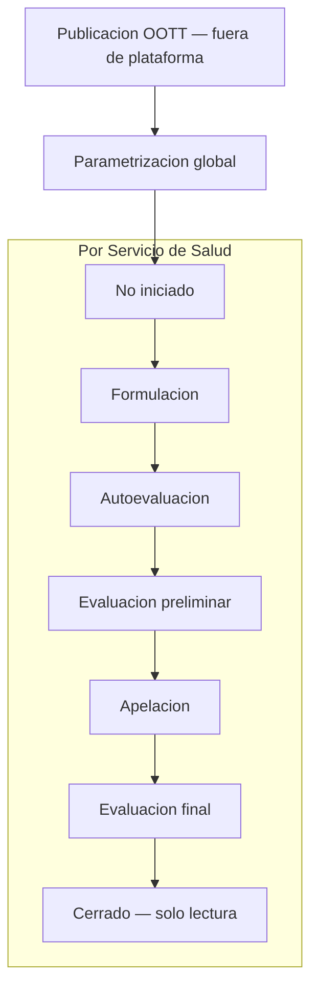

# Metas — ciclo de vida del módulo

Documento de **negocio** que describe el ciclo operativo de los instrumentos **Metas** (`metas-18834`, `metas-19664`, `metas-20707`, etc.) en Centinela: fases, roles y alcance (global vs por Servicio de Salud y establecimiento). Complementa el detalle de cálculo en [metas-calculo.md](metas-calculo.md).

**Reglas transversales:** [domain-rules.md](domain-rules.md) · [instrumentos-plataforma.md](instrumentos-plataforma.md) · [modulos-roles.md](modulos-roles.md)

**Referencias técnicas:** `MetStageAccessService` · `IndicatorTypeSetting`

Última formalización: **2026-09-01**.

---

## 1. Resumen

El ciclo Metas combina tres capas:

| Capa | Alcance | Responsable típico |
| ---- | ------- | ------------------ |
| **OOTT (fuera de plataforma)** | Marco normativo del año | MINSAL |
| **Parametrización del instrumento** | Global — catálogo para todos los SS | **parametrizador** |
| **Configuración y operación** | Por Servicio de Salud, establecimiento y año indicador | **control-gestion** (etapas, estructura) · **responsable de establecimiento** (convenio, apelaciones) · **referente** (carga de datos) |

Las **etapas vigentes** del instrumento por SS (`indicatorTypeSettings.etapa_vigente`) gobiernan qué puede hacer cada rol. A diferencia de COMGES, **no hay cortes fijos**: la carga intra-año se organiza por **períodos** derivados del tipo de entrada y agregación de cada indicador (mensual, trimestral, semestral, anual, línea base — ver [metas-calculo.md](metas-calculo.md) §2–3).

---

## 2. Fases del ciclo

### 2.1 Publicación de orientaciones técnicas (OOTT) — fuera de la plataforma

El ciclo **inicia fuera de Centinela** con la publicación, por parte del MINSAL, de las **orientaciones técnicas** (OOTT) que definen el marco del instrumento de Metas para el año en curso (según ley: 18.834, 19.664 o 20.707).

Centinela no modela esta fase; las OOTT son el insumo normativo que guía la parametrización posterior del catálogo.

### 2.2 Parametrización global del instrumento

**Rol:** parametrizador (y admin).

**Alcance:** una definición de **catálogo** para todos los Servicios de Salud del año indicador.

En base a las OOTT, el parametrizador configura en el panel administrativo (`/admin`):

- **Indicadores** del instrumento (fórmulas, metas de catálogo, umbrales de semáforo por fila).
- **Campos de datos** (`met_data_field`) con tipo de entrada y agregación por defecto.
- **Maquetas** y parámetros globales del instrumento.

Esta fase no depende de la etapa vigente por SS. La configuración por establecimiento (`aplica`, `meta_efectiva`, convenio) ocurre después, en etapas operativas del SS.

### 2.3 No iniciado

**Etapa vigente:** `NO_INICIADO` (estado inicial al crear el setting Metas de un SS).

**Comportamiento:**

- El instrumento **no es visible** para `referente` ni `visualizador` del SS (equivalente a `habilitado = false`).
- **control-gestion** y **admin** pueden acceder a la configuración del instrumento, pero **no** pueden editar la configuración estructural de establecimientos ni indicadores (`aplica`, `meta_efectiva`, inclusiones de centros).
- El CG debe **avanzar la etapa** a Formulación para iniciar la operación del ciclo.

### 2.4 Formulación

**Etapa vigente:** `FORMULACION`.

Al pasar a Formulación, el instrumento queda **habilitado** para referentes y visualizadores del SS.

**control-gestion** (y admin):

- Incluye o excluye **establecimientos** y, en Metas 20.707, **unidades internas** de medición.
- Configura por indicador-establecimiento: **`aplica`**, **`meta_efectiva`**, **`agrupa_ss`**.
- Designa **responsables de establecimiento** por centro.

**Responsable de establecimiento** (designación, no rol Voyager):

- Selecciona indicadores **en convenio** y define **ponderaciones** (estados `Borrador` / `Enviado` con firma de envío).
- Puede guardar borrador o enviar el convenio al SS.

**Carga de datos:** permitida también en Formulación (no exige esperar a Autoevaluación). Condiciones: indicador aplicable, referente asignado al indicador, responsable designado del centro y tipos de entrada completos por SS (DR-205-08).

Al salir de Formulación, el convenio (`seleccionado` y `ponderacion`) queda **congelado** para todos los roles.

### 2.5 Autoevaluación

**Etapa vigente:** `AUTOEVALUACION`.

**Carga periódica** de datos en `met_monthly_data` y seguimiento del cumplimiento período a período.

| Rol | Acción |
| --- | ------ |
| **referente** (asignado al indicador) | Carga datos si además es responsable designado del centro (o el centro está en su ámbito de adosados) y el indicador aplica. |
| **responsable de establecimiento** | Opera el convenio solo en lectura; carga datos bajo las mismas reglas que referente cuando cumple asignación. |
| **control-gestion** | Carga y gestión en su SS; mantiene configuración estructural (`aplica`, `meta_efectiva`, centros, unidades). |

**Sin cortes COMGES:** los períodos de carga (`MES-*`, `TRIM-*`, `SEM-*`, `ANUAL`) se derivan del `input_type` y `aggregation_type` de cada campo, configurables por SS ([metas-calculo.md](metas-calculo.md) §2–3).

El motor calcula y persiste resultados con `etapa = AUTOEVALUACION` en `met_results` / `met_establishment_results`.

### 2.6 Evaluación preliminar

**Etapa vigente:** `PRELIMINAR`.

**Rol principal:** control de gestión (y admin).

El CG **registra la evaluación preliminar** — resultados de la evaluación externa (MINSAL, SEREMI, DIPRES u otro organismo según el marco del año). Captura num/den anual por indicador-establecimiento en `met_preliminary_evaluations`; el recálculo persiste en `met_results` con `etapa = PRELIMINAR`.

Referentes y responsables de establecimiento: **solo lectura** en esta etapa.

### 2.7 Apelación

**Etapa vigente:** `APELACION`.

**Rol principal:** **responsable de establecimiento** designado para ese centro.

Puede registrar **apelaciones** por indicador (motivo, tipo de causa, adjuntos) para solicitar la mantención de un indicador con incumplimiento. No es el referente genérico del indicador: la autorización exige designación explícita como responsable del establecimiento (`MetStageAccessService::canAppeal`).

CG y admin pueden consultar y operar según políticas del módulo; la carga de apelaciones es del responsable designado.

### 2.8 Evaluación final

**Etapa vigente:** `FINAL`.

**Rol principal:** control de gestión (y admin).

El CG **registra la evaluación final** del período en `met_final_evaluations`, incorporando resoluciones de apelaciones cuando corresponda (notas de resolución con trazabilidad — ver [metas-calculo.md](metas-calculo.md) §7.3).

### 2.9 Cerrado

**Etapa vigente:** `CERRADO`.

El ciclo del año indicador para ese SS **concluye**. **Solo lectura para todos los roles**, incluidos admin y control-gestion. No hay edición de convenio, carga, apelaciones ni evaluaciones.

---

## 3. Etapas vigentes vs resultados persistidos

| Concepto | Descripción |
| -------- | ----------- |
| **Etapa vigente** | Fase del ciclo a nivel SS-año (`indicatorTypeSettings`). Ciclo Metas: `NO_INICIADO` → `FORMULACION` → `AUTOEVALUACION` → `PRELIMINAR` → `APELACION` → `FINAL` → `CERRADO`. |
| **Etapa en resultados** | Discriminador en `met_results` / `met_establishment_results`: `AUTOEVALUACION`, `PRELIMINAR`, `FINAL`. **No** existe `FORMULACION` como etapa de resultado (DR-205-10). |
| **Convenio** | `seleccionado` + `ponderacion` en `met_indicator_configurations`; editable solo en `FORMULACION`. |
| **Período de carga** | `MES-*`, `TRIM-*`, `SEM-*`, `ANUAL` — distinto de etapa vigente y de cortes COMGES. |
| **Transición de etapa** | Solo admin y CG; retroceso exige **motivo escrito** y queda en `met_stage_transitions`. |

---

## 4. Políticas de edición por etapa

Resumen alineado con `MetStageAccessService` y:

| Etapa | Convenio / ponderaciones | Config. estructural (aplica, meta, centros) | Carga mensual | Preliminar / Final | Apelaciones |
| ----- | ------------------------ | ------------------------------------------- | ------------- | ------------------ | ----------- |
| **No iniciado** | — | Bloqueada | — | — | — |
| **Formulación** | Responsable / CG | CG / admin | Sí (condiciones DR-205-08) | — | — |
| **Autoevaluación** | Solo lectura | CG / admin | Sí | — | — |
| **Preliminar** | Solo lectura | CG / admin | Solo lectura | CG / admin | — |
| **Apelación** | Solo lectura | CG / admin | Solo lectura | Solo lectura | Responsable designado |
| **Final** | Solo lectura | Solo lectura | Solo lectura | CG / admin | Consulta |
| **Cerrado** | Solo lectura | Solo lectura | Solo lectura | Solo lectura | Solo lectura |

Detalle de matriz módulo × rol: [modulos-roles.md](modulos-roles.md) § Metas.

---

## 5. Diferencias con COMGES

| Dimensión | Metas | COMGES |
| --------- | ----- | ------ |
| **Inicio del ciclo** | OOTT (fuera de plataforma) → parametrización global | OOTT (fuera de plataforma) → parametrización global |
| **Parametrización** | Catálogo global; convenio y ponderaciones por establecimiento | Catálogo global; sensibilidad seleccionable por SS |
| **Granularidad de carga** | Establecimiento / unidad interna (20.707) | Servicio de Salud |
| **Calendario intra-año** | Períodos según `input_type` (mes/trim/sem/anual) | Cortes fijos según OOTT |
| **Etapas previas a carga** | No iniciado → Formulación | Configuración SS → Autoevaluación (sin No iniciado/Formulación) |
| **Apelación** | Responsable de establecimiento designado | Referente asignado al indicador |
| **Evaluación externa** | Preliminar y Final registradas por CG | Preliminar y Final registradas por CG |

Detalle COMGES: [comges-ciclo-vida.md](comges-ciclo-vida.md).

---

## 6. Checklist rápido para specs Metas (ciclo)

- [ ] ¿Afecta parametrización global vs configuración por SS o establecimiento?
- [ ] ¿Impacta transición de `etapa_vigente` o historial `met_stage_transitions`?
- [ ] ¿Qué rol opera (parametrizador, CG, responsable de establecimiento, referente)?
- [ ] ¿Toca convenio (`seleccionado` / `ponderacion`) — solo editable en Formulación?
- [ ] ¿Toca configuración estructural (`aplica`, `meta_efectiva`, centros, unidades)?
- [ ] ¿Afecta carga en Formulación además de Autoevaluación?
- [ ] ¿Afecta `MetStageAccessService` o discriminador `etapa` en `met_results`?
- [ ] ¿Filtrado por `cen_hie_dependency_id` y año en sesión?
