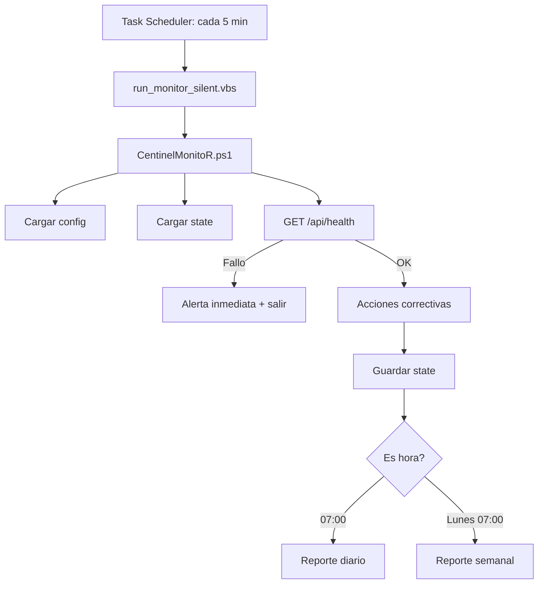

# Monitor externo Centinela (PC de monitoreo)

## Descripcion

Este monitor se ejecuta desde un PC externo (no el servidor de produccion) y verifica el estado de salud de la aplicacion Centinela mediante `GET /api/health`. Su diseno es simple:

- **Una sola llamada** a `GET /api/health` por ciclo (cada 5 min)
- **Alerta inmediata** solo si la app no responde tras N health checks fallidos consecutivos (default 3; configurable)
- **Acciones correctivas** via `POST /api/schedule/*` cuando corresponde
- **Reporte diario** con resumen de todos los eventos del dia
- **Reporte semanal** con tendencias y disponibilidad

## Flujo de ejecucion



## Archivos

```
scripts/monitor/
  run_monitor_silent.vbs         <-- Lanzador desde Task Scheduler (ventana oculta)
  CentinelMonitoR.ps1            <-- Orquestador principal
  config/
    monitor.config.json           <-- Configuracion (produccion, no versionado)
    monitor.config.example.json   <-- Ejemplo de configuracion
    monitor_state.json            <-- Estado persistente (no versionado)
    logs/                         <-- Logs diarios de ejecucion (rotacion automatica)
      monitor_YYYY-MM-DD.log
  lib/
    StateStore.ps1                <-- Lectura/escritura de estado persistente
    Mailer.ps1                    <-- Envio de correo SMTP
    HealthApi.ps1                 <-- LLamadas HTTP a endpoints
    ReportTemplates.ps1           <-- HTML de reportes diarios/semanales
  secrets/
    smtpPassword.sec              <-- Contrasena SMTP (SecureString)
    monitor.secrets.json          <-- bearerToken + cronToken (produccion)
    monitor.secrets.example.json  <-- Ejemplo de secrets
  docs/
    README.md                     <-- Este archivo
```

## Configuracion

### `config/monitor.config.json`

```json
{
    "baseUrl": "https://ejemplo.intranet.local/centinela",
    "schedulerRunIntervalMinutes": 60,
    "httpTimeoutSeconds": 30,
    "timeouts": {
        "health": 10,
        "schedule_run": 120,
        "queue_process": 60,
        "db_backup": 300
    },
    "securityWarningThreshold": 10,
    "alertAfterConsecutiveFailures": 3,
    "logRetentionDays": 31,
    "reporting": {
        "dailyAt": "07:00",
        "weeklyOnDay": 1
    },
    "smtp": {
        "server": "smtp.ejemplo.gob.cl",
        "port": 587,
        "useSsl": true,
        "fromAddress": "centinela-monitor@ejemplo.gob.cl",
        "fromName": "Monitor Centinela (PC externo)",
        "to": ["destinatario@ejemplo.gob.cl"],
        "passwordFile": "smtpPassword.sec"
    }
}
```

| Parametro                     | Default          | Descripcion                                                              |
| ----------------------------- | ---------------- | ------------------------------------------------------------------------ |
| `baseUrl`                     | —                | URL base de la aplicacion Centinela (obligatorio)                        |
| `schedulerRunIntervalMinutes` | 60               | Minutos minimos entre ejecuciones de POST /api/schedule/run              |
| `queueDrainMax`               | 30               | Jobs max por ciclo en POST /api/schedule/queue/process (`queue=default`) |
| `httpTimeoutSeconds`          | 30               | Timeout por defecto para llamadas HTTP                                   |
| `timeouts.health`             | 30               | Timeout para GET /api/health (10s recomendado)                           |
| `timeouts.schedule_run`       | 30               | Timeout para POST /api/schedule/run (120s recomendado)                   |
| `timeouts.queue_process`      | 30               | Timeout para POST /api/schedule/queue/process (60s recomendado)          |
| `timeouts.db_backup`          | 30               | Timeout para POST /api/schedule/backup/database (300s recomendado)       |
| `securityWarningThreshold`         | 10               | Intentos de login fallidos en 24h para generar advertencia en reporte    |
| `alertAfterConsecutiveFailures`    | 3                | Fallos consecutivos de health check antes de enviar alerta por correo    |
| `logRetentionDays`            | 31               | Dias de retencion de logs en config/logs/ (limpieza post-reporte)        |
| `reporting.dailyAt`           | 07:00            | Hora de envio del reporte diario                                         |
| `reporting.weeklyOnDay`       | 1                | Dia de la semana para reporte semanal (1=lunes)                          |
| `smtp.server`                 | smtp.ejemplo.gob.cl | Servidor SMTP                                                         |
| `smtp.port`                   | 587              | Puerto SMTP                                                              |
| `smtp.useSsl`                 | true             | Usar TLS/SSL en SMTP                                                     |
| `smtp.fromAddress`            | —                | Cuenta remitente (usuario SMTP)                                          |
| `smtp.fromName`               | —                | Nombre visible del remitente                                             |
| `smtp.to`                     | —                | Lista de destinatarios (alertas y reportes)                              |
| `smtp.passwordFile`           | smtpPassword.sec | Archivo en `secrets/` con la contraseña (SecureString)                   |

### Logs de ejecucion

El monitor escribe automaticamente un archivo de log por dia en `config/logs/monitor_YYYY-MM-DD.log`. Cada ciclo (cada 5 min) genera ~10 lineas (~500 bytes). Rotacion diaria automatica (~4 MB/mes).

La limpieza de logs antiguos se ejecuta automaticamente despues de enviar cada reporte (diario o semanal), respetando el parametro `logRetentionDays` (default: 31 dias).

Para revisar el ultimo ciclo:

```powershell
Get-Content "config/logs/monitor_$(Get-Date -Format 'yyyy-MM-dd').log" -Tail 10
```

### `secrets/monitor.secrets.json`

```json
{
    "bearerToken": "TOKEN_SANCTUM_DE_ADMIN",
    "cronToken": "VALOR_DE_CRON_SECRET_TOKEN"
}
```

### SMTP

Servidor, puerto, remitente y destinatarios se configuran en `config/monitor.config.json` bajo la clave `smtp`. La contrasena **no** va en el JSON: se guarda en `secrets/` (nombre por defecto `smtpPassword.sec`, configurable con `smtp.passwordFile`).

Para crear el archivo de contraseña:

```powershell
Read-Host -AsSecureString | ConvertFrom-SecureString | Out-File secrets/smtpPassword.sec
```

Lectura (internamente el monitor usa `Get-Content secrets/smtpPassword.sec | ConvertTo-SecureString`).

## Dos schedulers (TS-Externo vs TS-Producción)

| Scheduler                     | Dónde        | Frecuencia               | Responsabilidad                                                                             |
| ----------------------------- | ------------ | ------------------------ | ------------------------------------------------------------------------------------------- |
| **TS-Externo** (este monitor) | PC monitoreo | Cada 5 min               | Health; `queue/process` **default** (salvo 00:00–00:45); `schedule/run` horario **excepto 00:00**; backup recovery **nunca** 08:00–20:00 ni 00:00–00:45 |
| **TS-Producción**             | Servidor IIS | 1×/día **00:00** (`cron_mail.bat`, usuario Git) | `schedule:run` (lote Kernel + dump) + `queue:work --queue=releases` (único drenaje de deploys) |

El monitor **nunca** drena la cola `releases` (deploy). Esa cola la procesa **solo** [`cron_mail.bat`](../../../cron_mail.bat) a las **00:00**, con el usuario Windows que tiene credenciales Git (SDD-196). Un deploy encolado de día espera esa ventana.

## Endpoints consumidos

| Endpoint                        | Metodo | Auth                 | Parametros                 | Cuando se llama                    |
| ------------------------------- | ------ | -------------------- | -------------------------- | ---------------------------------- |
| `/api/health`                   | GET    | Publico              | `?compact=1` (modo ligero) | Cada ciclo                         |
| `/api/schedule/run`             | POST   | cron.token + Sanctum | —                          | Cada 60 min en `:00` **excepto 00:00** |
| `/api/schedule/queue/process`   | POST   | cron.token + Sanctum | `max`, `queue=default`     | Cada ciclo **salvo 00:00–00:45**   |
| `/api/schedule/backup/database` | POST   | cron.token + Sanctum | —                          | Backup ≠ ok, **fuera** de 08:00–20:00 y de 00:00–00:45 (p. ej. 01:00) |

## Campos de respuesta relevantes

| Endpoint                             | Campo nuevo                   | Descripcion                                           |
| ------------------------------------ | ----------------------------- | ----------------------------------------------------- |
| `GET /api/health`                    | `duration_ms`                 | Tiempo total de respuesta del health check (raiz)     |
| `GET /api/health`                    | `.scheduler.duration_ms`      | Latencia del subsistema scheduler                     |
| `GET /api/health`                    | `.worker.duration_ms`         | Latencias del subsistema worker                       |
| `GET /api/health`                    | `.backup.duration_ms`         | Latencias del subsistema backup (solo modo normal)    |
| `GET /api/health`                    | `.security.duration_ms`       | Latencias del subsistema seguridad (solo modo normal) |
| `GET /api/health`                    | `.worker.oldest_queued_at`    | Fecha ISO del job mas antiguo encolado                |
| `GET /api/health`                    | `.worker.oldest_available_at` | Fecha ISO del job mas antiguo disponible              |
| `POST /api/schedule/backup/database` | `file`                        | Nombre del archivo de backup generado                 |
| `POST /api/schedule/backup/database` | `size_mb`                     | Tamano del archivo en MB                              |
| `POST /api/schedule/backup/database` | `duration_ms`                 | Duracion total del backup en milisegundos             |

## Reglas de alertas

| Evento                                        | Accion                                       |
| --------------------------------------------- | -------------------------------------------- |
| `GET /api/health` falla (timeout, error HTTP) | Registrar en state; correo tras N fallos consecutivos (default 3, max 1 cada 2h) |
| Worker down con jobs pendientes               | Drenar cola via API, registrado en reporte   |
| Worker down sin jobs                          | Solo en reporte diario                       |
| Scheduler no responde                         | Ejecutar schedule:run, registrado en reporte |
| Backup desactualizado                         | Recuperar dump **solo** fuera de 08:00–20:00 y fuera de 00:00–00:45 |
| Muchos intentos de login fallidos             | Advertencia en reporte diario                |

## Reportes (SDD-243)

**Un solo correo diario ops** sale de este Monitor (~`reporting.dailyAt`, default 07:00). INTRA ya **no** envia `schedule:daily-report` por SMTP.

- **Diario (07:00)**: Ciclos del dia anterior (borde) + seccion **INTRA/Kernel** desde `GET /api/health` completo (scheduler, backup, worker). Banner **honesto**: no declara "Saludable" si hay fallos de borde o senales Kernel en fallo/timeout.
- **Semanal (lunes 07:00)**: Agrega 7 dias (disponibilidad, dias con fallos, health FAIL) + snapshot INTRA al enviar. Conservar y reforzar; no hay segundo semanal desde Laravel.

Lote Kernel nocturno: **00:00** (no 12:00). Valle monitor 00:00-00:45 sin cola/backup/`schedule:run` a las 00:00.

## Instalacion en PC externo

1. Clonar repositorio (rama `dev`)
2. Copiar `scripts/monitor/secrets/monitor.secrets.example.json` como `monitor.secrets.json` y completar con los valores reales (`bearerToken` + `cronToken`)
3. Crear `secrets/smtpPassword.sec` con la contrasena SMTP
4. Crear `config/monitor.config.json` con la URL de produccion
5. Configurar el Programador de Tareas de Windows:
    - Programa: `powershell.exe`
    - Argumentos: `-NoProfile -ExecutionPolicy Bypass -File "C:\ruta\scripts\monitor\CentinelMonitoR.ps1" -ConfigPath "C:\ruta\scripts\monitor\config\monitor.config.json"`
    - Frecuencia: cada 5 minutos
    - Opcional: usar `run_monitor_silent.vbs` como lanzador sin ventana visible

Para usar el VBS (ventana oculta):

- Programa: `wscript.exe`
- Argumentos: `"C:\ruta\scripts\monitor\run_monitor_silent.vbs"`
- Frecuencia: cada 5 minutos

## Propuestas de mejora para endpoints (roadmap)

Ver [SDD-061](../../../.github/docs/sdd/archive/2026/supervision/SDD-061b-monitoreo-v2.md) para las propuestas de simplificacion de autenticacion y nuevos endpoints.

## Spec

- [SDD-061 - Monitor V2](../../../.github/docs/sdd/archive/2026/supervision/SDD-061b-monitoreo-v2.md)
- [SDD-044 - Monitor legacy (deprecado)](../../../.github/docs/sdd/archive/2026/supervision/SDD-044-supervision-01-runtime-api-monitor.md)
